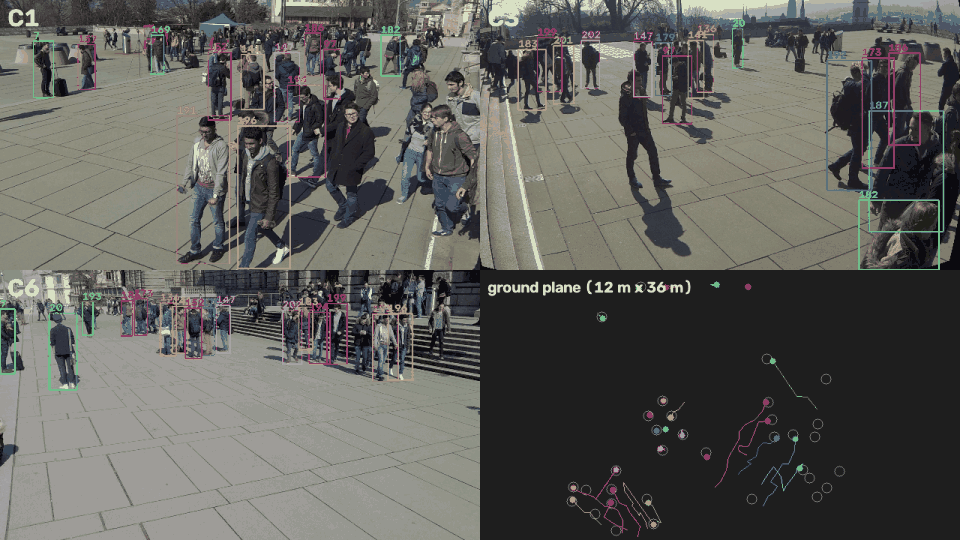
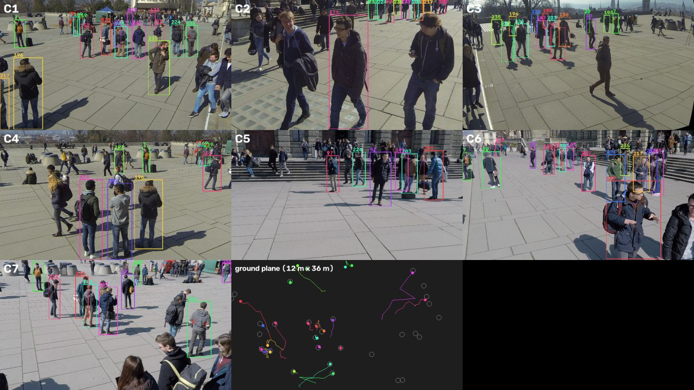

# Multi-Camera Multi-Object Tracking

Track every pedestrian across 7 overlapping cameras and give each person **one identity in all cameras**, on the
[WILDTRACK](https://www.epfl.ch/labs/cvlab/data/data-wildtrack/) dataset. The pipeline uses only pretrained models
(no training).



*Model predictions on WILDTRACK (20 s of the 2 fps sequence, played at 2x). Box colour and number = global identity:
the same person keeps the same number in every camera. Bird's-eye view: coloured dots and trails = tracker, grey rings
= ground truth.*

Pipeline:

```
7 camera frames ─► YOLO11 person detection ─► appearance embedding ─► DeepSORT (one tracker per camera)
                                                                                │  local tracks
                                       foot point ─► ground plane (calibration) ┘
                                                          │
           fuse cameras per frame (same place = same person) ─► ground-plane tracking ─► global ids ─► MOTA / IDF1
```

## Setup

```bash
uv sync                                   # Python 3.10-3.12, CUDA PyTorch
bash scripts/download_wildtrack.sh        # ~6.8 GB -> data/Wildtrack
uv run pytest                             # unit tests (+ a calibration check once the data is present)
```

## Run

```bash
uv run python -m mcmot.run                                   # all 400 frames, writes outputs/wildtrack/
uv run python -m mcmot.run --set frames=test                 # standard test split (last 40 frames)
uv run python -m mcmot.run --set tracker.max_age=10 association.fuse_radius_cm=100 --no-video
```

Outputs in `outputs/wildtrack/`: `metrics.json`, `tracks_per_camera.csv` (box, local id, global id, ground
position per camera and frame), `tracks_ground.csv` (one ground position per person and frame), `tracking.mp4`
(7 views + bird's-eye view).

All seven cameras at one moment:



Regenerate both images from a finished run (no models needed): `uv run python scripts/make_demo.py`
(`--cams`, `--start`, `--frames` choose the cameras and the time window).

## Dataset: WILDTRACK

7 synchronised HD cameras (1920x1080) filming a square at EPFL, with heavily overlapping views. 400 annotated frames
per camera at 2 fps (every 5th frame of the 10 fps video), 313 pedestrian identities. Each annotation gives a person's
position on a 12 m x 36 m ground grid (2.5 cm cells) plus their box in every camera that sees them. All cameras are
calibrated (intrinsics + extrinsics), which is what makes cross-camera association possible.

## Pipeline

| Step | Module | What happens |
|---|---|---|
| 1. Load | `wildtrack.py` | Read the 7 images of a frame (already undistorted), annotations and calibration. |
| 2. Detect | `detection.py` | COCO-pretrained YOLO11m, class *person*, input 1280 px, confidence ≥ 0.3. |
| 3. Embed | `tracking.py` | Crop every box, resize to 224x224, MobileNetV2 features (1280-d, L2-normalised). |
| 4. Track per camera | `tracking.py` | DeepSORT: Kalman-filter motion prediction + Hungarian matching on appearance (cosine) gated by motion, then IoU. Confirmed after 2 hits, dropped after 5 missed frames. |
| 5. Project | `geometry.py` | Bottom-centre of each box (the feet) → ground plane via the homography `H = K [r1 r2 t]`. Boxes whose feet land outside the annotated area are dropped (WILDTRACK labels only that area). |
| 6. Fuse cameras | `association.py` | Per frame, ground points of different cameras within 1.25 m are one person (complete linkage, at most one box per camera). Position = mean. People seen by only one camera are dropped: those points are mostly occluded boxes projected to the wrong place. |
| 7. Track on the ground | `association.py` | Hungarian matching of fused people to global tracks: cost = distance to the predicted position (constant velocity, gate 1 m per 0.5 s) − share of the person's DeepSORT ids that already belong to that track (ID votes). New tracks for unmatched people; tracks end after 5 unseen frames; tracks shorter than 5 frames are dropped. |
| 8. Evaluate | `evaluate.py` | MOTA / IDF1 per camera, across cameras, and on the ground plane. |

## Metrics

| Name | Measures |
|---|---|
| **MOTA** | 1 − (misses + false positives + id switches) / ground-truth objects. Detection-dominated. |
| **IDF1** | Share of detections assigned the correct identity over time. Identity-dominated. |
| per camera C1–C7 | Single-camera tracking (local DeepSORT ids, box IoU ≥ 0.5). |
| cross_camera | All cameras together with global ids: a person must keep the same id in every camera. |
| ground | Ground-plane positions with global ids (match within 1 m), the usual WILDTRACK tracking metric. |

## Results

Pretrained models only, RTX 3090, ~8 min for 400 frames x 7 cameras (detection dominates).

| View | All 400 frames: MOTA | IDF1 | Precision | Recall | Test split (last 40): MOTA | IDF1 |
|---|---|---|---|---|---|---|
| **ground** (1 m) | **0.492** | **0.580** | 0.787 | 0.715 | **0.637** | **0.753** |
| cross_camera (boxes, global ids) | 0.319 | 0.418 | 0.776 | 0.508 | 0.358 | 0.540 |
| per camera, mean C1-C7 | 0.275 | 0.445 | 0.760 | 0.530 | 0.315 | 0.511 |

313 people in the ground truth, 283 global identities found. Camera C4 is the weak one (MOTA −0.31): it sees mostly
the edge of the area, where few people are annotated. The association settings (`fuse_radius_cm`, `min_cameras`)
were chosen by comparing a few values on all 400 frames, so treat these numbers as a baseline, not a benchmark
result. For comparison, published multi-view trackers trained on WILDTRACK reach ground MOTA around 0.85-0.9.

What the association redesign changed (same detections and DeepSORT tracks, all frames, ground plane):

| Association | MOTA | IDF1 |
|---|---|---|
| Tracklet clustering, all boxes | −0.439 | 0.450 |
| + drop boxes outside the annotated area | −0.274 | 0.470 |
| Fuse per frame + ground tracking (1 camera enough) | 0.239 | 0.482 |
| + require ≥ 2 cameras (final) | 0.492 | 0.580 |

## Known limitations / next steps

- The appearance model is an ImageNet MobileNetV2, not a person re-identification model; swapping in a ReID model
  (e.g. OSNet trained on Market-1501) should reduce DeepSORT identity switches, which the ground tracker inherits.
- Requiring 2 cameras removes most false positives but also people only one camera sees (recall 0.72).
- 2 fps is coarse for a Kalman filter: people move up to ~1 m between frames.
- Feet of people cut off by the image border or occluded project to wrong ground positions.
- Detection is per camera; multi-view detectors (MVDet, EarlyBird) fuse all views before detecting and are much
  stronger on WILDTRACK's crowded, occluded scenes.
